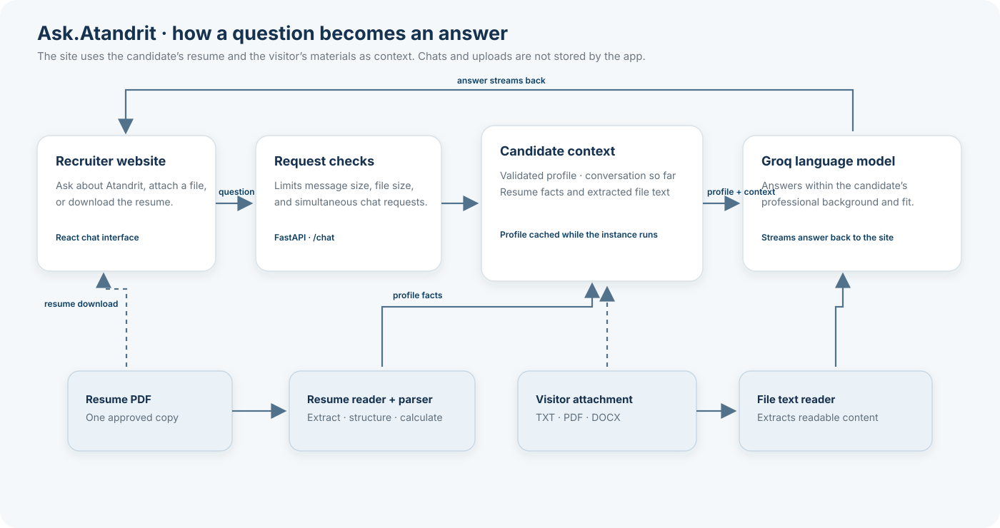

<div align="center">

# Ask.Atandrit

### A portfolio you talk to — not one you scroll.

Ask about Atandrit’s experience, projects, and skills. Answers are grounded in his resume—and in any materials you choose to share.

[**Try the live chatbot →**](https://ask-atandrit.vercel.app/)

<br />


</div>

---

## In this README

[What it does](#what-it-does) · [How it works](#how-it-works) · [Get started](#get-started) · [Run locally](#run-locally) · [Privacy and limits](#privacy-and-limits) · [Deploy](#deploy-to-vercel) · [Known limitations](#known-limitations)

## What it does

Ask.Atandrit turns a traditional portfolio into a chat. Recruiters can ask natural-language questions about Atandrit’s background, get streamed answers based on a structured resume profile, share a document for added context, or download the public resume.

- **Resume-grounded answers** — Groq extracts a structured profile from the resume; Pydantic validates it before use.
- **Useful experience details** — Python calculates inclusive role durations, combines overlapping roles for total experience, and formats periods in years and months.
- **A focused recruiter experience** — responsive React chat UI, streaming replies, file attachments, light and dark themes, and an optional resume download.
- **A small, stateless API** — FastAPI provides health, chat, and resume endpoints. The app does not save chat history or visitor uploads.

## How it works

<div align="center">



</div>

The browser sends the current conversation and any attached files with each question. The API extracts readable text, combines it with the in-memory candidate profile, and streams a response. Earlier messages and attachments are supplied again by the browser on each request; the API does not persist them.

## Get started

### Requirements

- Python **3.14 or newer**
- [uv](https://docs.astral.sh/uv/)
- Node.js and npm (for the website)
- A [Groq API key](https://console.groq.com/keys)

### Prepare the project

```bash
git clone https://github.com/atandritC/AskAtandrit.git
cd AskAtandrit
uv sync
mkdir -p data/resume
```

Place one PDF resume in `data/resume/`. The folder is ignored by Git. For a deployment that serves a downloadable resume, use the explicitly permitted filename `data/resume/public-resume.pdf` and only include a copy you intend to make public.

Create a `.env` file in the project root:

```dotenv
GROQ_API_KEY=your_groq_api_key
```

Keep the key and private resume out of Git.

## Run locally

### Chat in the terminal

```bash
uv run python -m portfolio_chatbot.chat
```

This parses the resume, builds a validated profile, asks one question, and streams an answer in the terminal.

### Start the API

```bash
uv run uvicorn portfolio_chatbot.api:app --reload
```

- API documentation: <http://127.0.0.1:8000/docs>
- Health check: <http://127.0.0.1:8000/health>

`POST /chat` accepts a conversation and optional `.txt`, text-based `.pdf`, or `.docx` attachments. The response streams to the caller. The profile is cached for the life of the process; restart the server after replacing the resume.

### Start the website

With the API running, open another terminal:

```bash
cd frontend
npm install
npm run dev
```

Open the local address printed by Vite, usually <http://localhost:5173>. The development website forwards API requests to the backend on port 8000.

To serve a production build through FastAPI instead:

```bash
cd frontend
npm run build
cd ..
uv run uvicorn portfolio_chatbot.api:app
```

Then open <http://127.0.0.1:8000>.

### Read the resume without the LLM

```bash
uv run python read_resume.py
```

This extracts and prints text from the resume PDF.

### Run the checks

```bash
uv run pytest
```

The tests cover role durations, overlapping roles, missing dates, fixed reference dates for current roles, and years-and-months formatting.

## Privacy and limits

The app keeps conversations and uploaded files in the request flow and does not save them. The parsed resume profile stays in memory while an instance runs. The profile is sent to Groq to generate answers, so use a resume you are authorized to process and keep private copies out of public deployment files.

Request safeguards include:

- 4 MB maximum request body
- Up to 3 files per request, 1 MB each and 2.5 MB combined
- Up to 20 conversation messages
- Up to 40,000 characters for conversation text and extracted attachment text
- PDF attachments up to 80 pages
- Resume PDFs up to 5 MB, 80 pages, and 100,000 extracted characters
- A 45-second Groq timeout, no retries, and answers capped at 1,000 tokens
- Up to 3 simultaneous chat generations per running app instance

The per-instance concurrency limit is not a shared, per-IP rate limit. For a public Vercel deployment, configure a Vercel Firewall rate-limit rule for `POST /chat` (the project’s deployment guidance starts at 10 requests per minute per IP and recommends reviewing traffic before enforcement).

## Deploy to Vercel

The repository is configured to build the React website and serve the FastAPI app from the repository root.

1. Import this repository into Vercel with the repository root as the project root.
2. Add `GROQ_API_KEY` to Vercel environment variables for each deployment environment. Do not add it to frontend settings or commit it.
3. If visitors should download a resume, add a public-safe `data/resume/public-resume.pdf` to the repository. A resume that exists only on your computer will not be available to the deployment.
4. Configure and review a Vercel Firewall rate limit for `POST /chat` before broadly sharing the deployment.
5. Deploy and check the website, `/health`, `/resume`, and a streamed chat response.

Vercel functions can start fresh instances at any time. The parsed profile cache is temporary and may be rebuilt after a cold start; chat history and visitor uploads are not saved by this app. The function is configured for up to 120 seconds.

## Known limitations

- Scanned PDFs need OCR; only text that can be extracted from the PDF is available.
- The profile cache is in-memory and is rebuilt when an instance starts.
- Vercel’s per-instance concurrency cap does not enforce a global traffic limit. Use the Firewall for shared request limiting.
- The deployed site can only serve a resume included as the public-safe `public-resume.pdf` file.

---

<div align="center">

Built with Python, FastAPI, React, and Groq · [Open Ask.Atandrit](https://ask-atandrit.vercel.app/)

</div>
