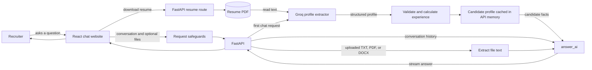

# Portfolio Chatbot

An AI portfolio project that will let recruiters ask questions about a candidate's experience, projects, and skills. The goal is to answer from the candidate's real information and be clear when the available information does not support an answer.

## Current progress

- Reads text from one PDF resume in `data/resume/`; the PDF can be replaced without changing the code.
- Uses Groq to extract a structured candidate profile from the resume and validates the result with Pydantic.
- The profile includes projects, skills, experience, organization locations, and the original date period from the resume. Python counts inclusive calendar months, merges overlapping roles for the total, and formats durations as years and months (for example, `1 year 9 months`).
- A FastAPI backend is available with a health check, a streaming `/chat` endpoint, and a resume download.
- A responsive React website provides the recruiter chat interface, streaming answers, file attachments, light/dark themes, and a download link for the resume.
- Private resume files and API secrets are excluded from Git. Only the explicitly named `data/resume/public-resume.pdf` is allowed as a public deployment copy.

## How it works



The website sends the conversation history and any attached files with each question. The API does not save chats or uploads; it keeps the parsed profile in memory while the server runs.

Chat requests are limited to 4 MB overall, three files of at most 1 MB each (2.5 MB combined), 20 messages, and 40,000 characters each for conversation text and extracted attachment text. Supported PDFs are limited to 80 pages. These limits reduce resource use; they do not replace Vercel's platform protections or a shared rate limit.

## Requirements

- Python 3.14 or newer
- [uv](https://docs.astral.sh/uv/)
- Node.js and npm
- A Groq API key for the profile parser

## Setup

Clone the repository, then from its root folder run:

```bash
uv sync
mkdir -p data/resume
```

Put one local PDF resume in `data/resume/`. The folder's contents are ignored by Git. If you add the explicit public copy `public-resume.pdf`, it takes priority and is the only resume file allowed into Git.

Create a `.env` file in the project root and add your Groq API key:

```text
GROQ_API_KEY=your_key_here
```

Keep `.env` private; it is ignored by Git.

## Run the chatbot

```bash
uv run python -m portfolio_chatbot.chat
```

The CLI parses the resume into a validated candidate profile, calculates and formats experience durations in Python, asks one question, and streams an answer grounded in that profile. The profile contains personal information and is sent to Groq; keep it private and do not commit or share it.

## Run the API

```bash
uv run uvicorn portfolio_chatbot.api:app --reload
```

Open `http://127.0.0.1:8000/docs` to try the API. `POST /chat` accepts a conversation, optional `.txt`, text-based `.pdf`, or `.docx` attachments, and streams a reply. Attachments can provide extra context for any question. The caller sends earlier messages and any attachments it wants considered with each request; the API does not save conversations or attachments. The parsed resume profile is reused while the server runs. Restart the server after replacing the resume. Scanned PDFs need OCR and are not readable yet.

## Run the website locally

Install Node.js, then open two terminals in the project folder.

In the first terminal, start the backend:

```bash
uv run uvicorn portfolio_chatbot.api:app --reload
```

In the second terminal, start the website:

```bash
cd frontend
npm install
npm run dev
```

Open the local website address printed by Vite (usually `http://localhost:5173`). The site forwards chat, health, and resume requests to the backend on port 8000. For a production-style local run, build the website with `npm run build` inside `frontend`, then open `http://127.0.0.1:8000`; FastAPI serves the built website and `/resume` serves the current PDF from `data/resume/`.

## Read the resume without the LLM

```bash
uv run python read_resume.py
```

This extracts and prints the text from the resume PDF. Do not commit your `.env` file or resume PDF.

## Run tests

```bash
uv run pytest
```

The tests cover inclusive per-role duration, overlapping roles, missing dates, fixed reference dates for current roles, and years-and-months formatting.

## Deploy to Vercel

The repository is configured for Vercel to build the React website and run the FastAPI app in the same project. Vercel streams the chatbot response from the Python function.

Before deploying:

1. Import this repository into Vercel and set the project root to the repository root.
2. Add `GROQ_API_KEY` in the Vercel project settings for each environment you plan to use. Do not put the key in frontend settings or commit it.
3. Prepare a **public-safe** resume copy named `data/resume/public-resume.pdf`. That exact filename is allowed by `.gitignore`; add it to Git only if you want anyone visiting the site to download it. The private local resume stays ignored. The public copy is needed because the deployed app cannot see a resume file that exists only on your computer.
4. Deploy a preview and open Vercel Firewall settings. Create a rate-limit rule for `POST /chat`, keyed by IP. Start with **10 requests per minute per IP**, review the traffic, then enforce it before sharing the public deployment. Vercel's shared rate limit is configured in the dashboard, not by the app. A small in-process concurrency cap cannot provide a global per-IP limit across serverless instances.
5. Promote the deployment and confirm the website, `/health`, `/resume`, and a streamed chat response work.

The app caps each uploaded file at 1 MB and checks the full request against a 4 MB limit, below Vercel Functions' 4.5 MB request-body limit. Resume PDFs are capped at 5 MB, 80 pages, and 100,000 extracted characters. The Groq request timeout is 45 seconds, retries are disabled, and answers are capped at 1,000 tokens. The Vercel function is configured for up to 120 seconds. Each running app instance accepts up to three simultaneous chat generations and returns `503` with `Retry-After` when full. Vercel's function can scale to other instances, so enforce public traffic limits with the Firewall rule too.

Vercel runs the Python function in a serverless environment. It can start a fresh instance at any time, so the parsed profile cache is temporary and may be rebuilt after a cold start. Chat history and visitor uploads are not saved by this app.
